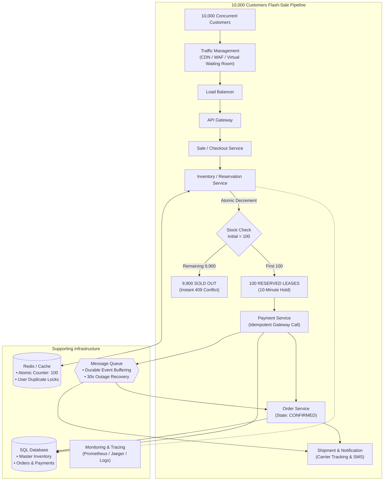

# Diagram 11: Final Architecture One-Page Blueprint

### Key Highlights
* **One-Way Pipeline:** Clean progression from traffic ingress through atomic reservation, payment, and order generation.
* **Invariant Enforced:** Exactly 100 units transition to `RESERVED`; 9,900 requests fail fast at the cache layer with zero database contention.
* **Decoupled by Queue:** If downstream fulfillment or Order Service stalls, the Message Queue buffers events with zero data loss.
* **Full Observability:** Telemetry tracks latency, queue backlog, and guarantees `available + reserved + sold == 100` at all times.
