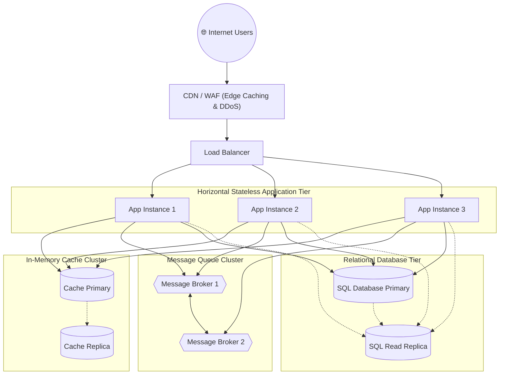

# Diagram 8: Deployment Diagram

### Key Highlights
* **Horizontal Scaling:** Stateless application instances scale out behind the Load Balancer to handle traffic surges.
* **Cache Primary-Replica:** Fast-path writes target Cache Primary; replicas stand by for sub-second automated failover.
* **Durable Message Clustering:** Message brokers are clustered to guarantee zero message loss during broker restarts.
* **Database Read/Write Splitting:** Heavy read queries target the Read Replica, reserving the Primary for critical inventory and payments.
