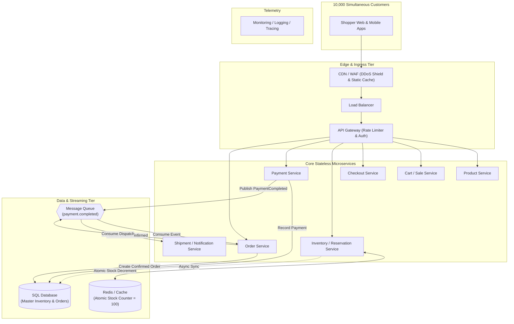

# Diagram 2: High-Level Architecture (HLD)

### Key Highlights
* **Traffic Ingress:** CDN and WAF filter and cache discovery traffic, forwarding only active Buy requests to the API Gateway.
* **Fast-Path Reservation:** The Reservation Service uses in-memory Cache for atomic decrement in $< 2\text{ms}$, shielding the database.
* **Asynchronous Handoff:** Payment completion emits an event to the Message Queue, decoupling Payment from Order creation.
* **Resilient Order Creation:** The Order Service consumes messages from the queue to create orders; if Order Service goes down, messages buffer safely.
