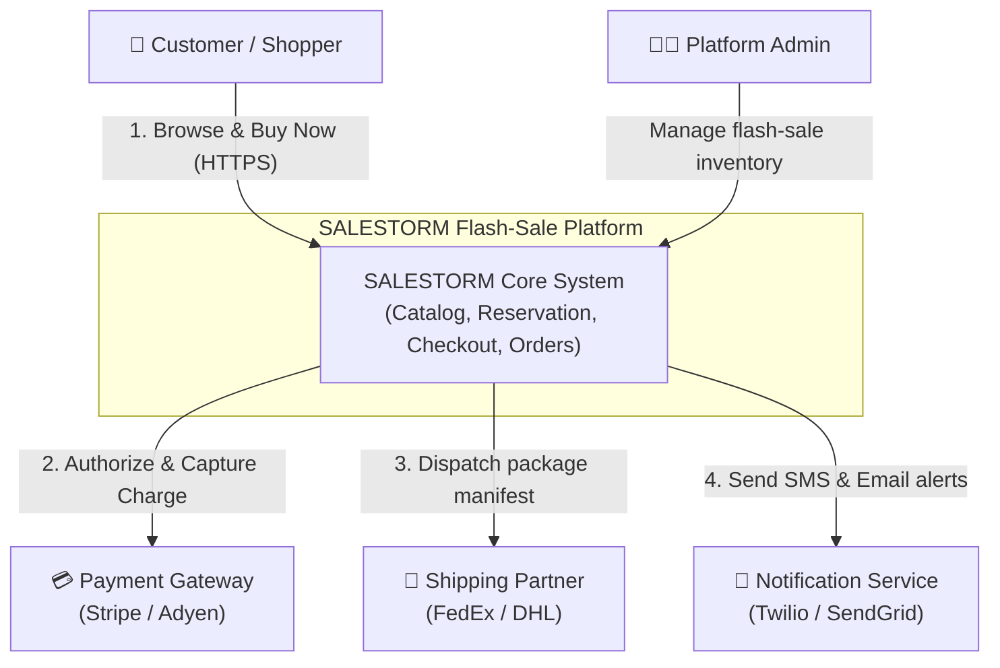

# Diagram 1: System Context Diagram

### Key Highlights
* **Customer Interface:** Customers interact via HTTPS to browse catalogs and initiate flash reservations.
* **Payment Isolation:** All card transactions route to external PCI-compliant Payment Gateways.
* **Fulfillment & Logistics:** Carrier integration is asynchronous; shipping manifests dispatch post-payment.
* **Notification Decoupling:** SMS/Email notifications are non-blocking; failure never delays or cancels an order.
