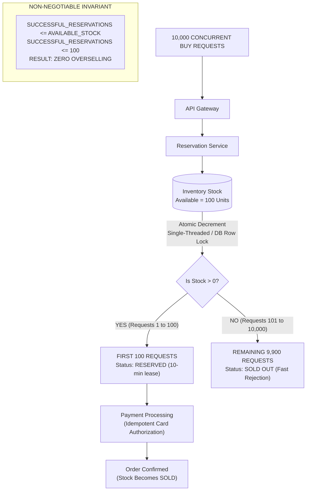

# Diagram 3: The Critical 10,000 → 100 Architecture Diagram

### Key Highlights
* **Strict Invariant Enforced:** `SUCCESSFUL_RESERVATIONS <= 100`. Available inventory can never drop below zero.
* **Instant Separation:** The first 100 requests decrement the counter atomically from 100 to 0 and claim temporary leases.
* **Fast Failure for 9,900:** The remaining 9,900 requests evaluate `stock == 0` and receive an immediate `SOLD_OUT` response in $< 15\text{ms}$.
* **Zero Database Overload:** Rejected requests never touch the SQL database, shielding backend connections from collapse.
