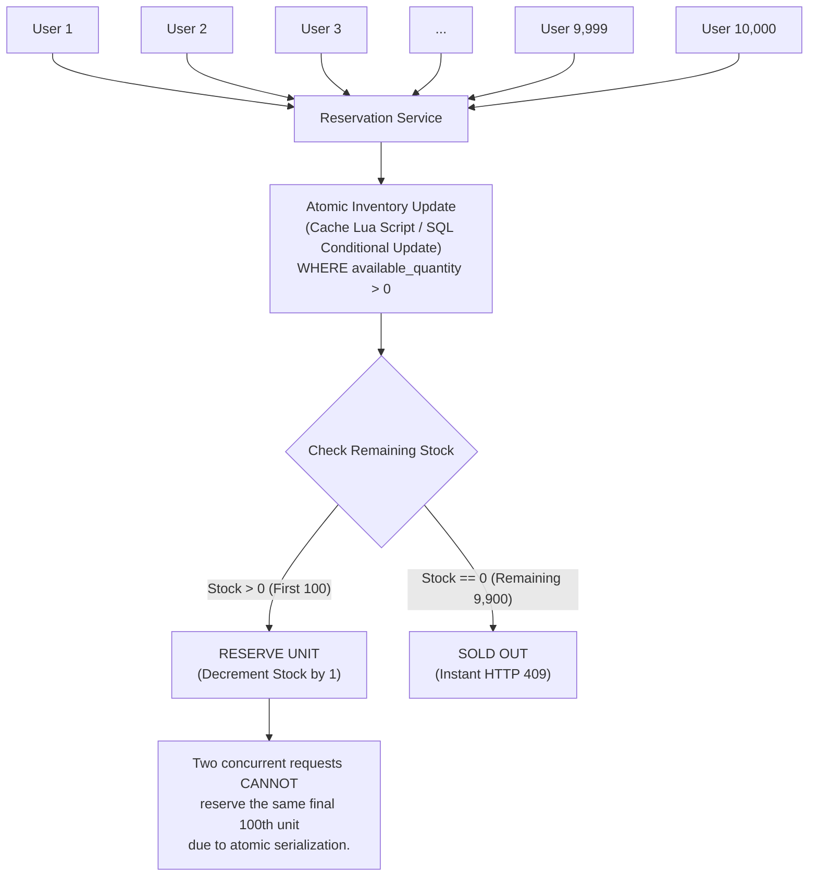

# Diagram 4: Inventory Concurrency Diagram

### Key Highlights
* **Atomic Serialization:** Concurrent incoming requests pass through a serialized atomic gate (in-memory single-thread or database row lock).
* **Guaranteed Unit Allocation:** Each winning request atomically decrements exactly 1 unit; two threads can never claim the same unit.
* **Conditional Gate:** The condition `available_quantity > 0` ensures that once stock hits 0, all subsequent updates return 0 affected rows.
* **Immediate Rejection:** Requests 101 to 10,000 fail immediately without waiting or blocking server threads.
