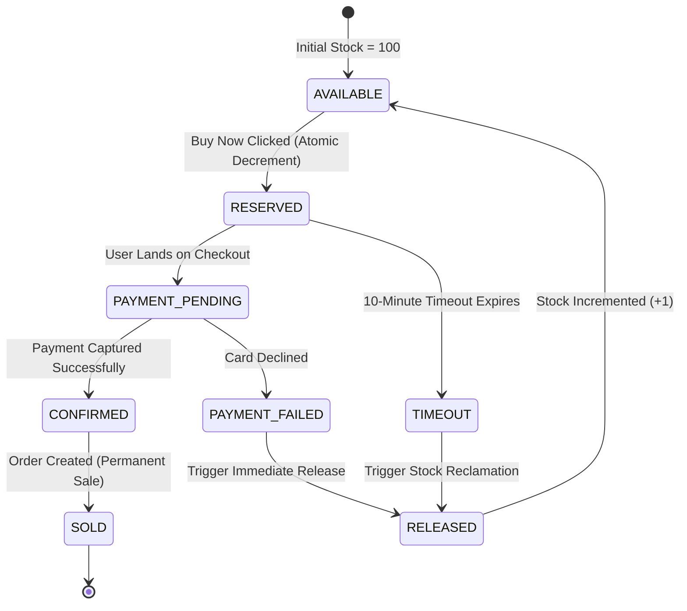

# Diagram 5: Reservation State Machine Diagram

### Key Highlights
* **Happy Path:** `AVAILABLE` $\to$ `RESERVED` $\to$ `PAYMENT_PENDING` $\to$ `CONFIRMED` $\to$ `SOLD`.
* **Lease Expiry Path:** If 10 minutes elapse without payment, state moves `RESERVED` $\to$ `TIMEOUT` $\to$ `RELEASED` $\to$ `AVAILABLE`.
* **Payment Failure Path:** If the card is declined, state moves `PAYMENT_PENDING` $\to$ `PAYMENT_FAILED` $\to$ `RELEASED` $\to$ `AVAILABLE`.
* **Zero Inventory Stranded:** Any failure or timeout automatically returns the unit back to `AVAILABLE` for the next waiting customer.
