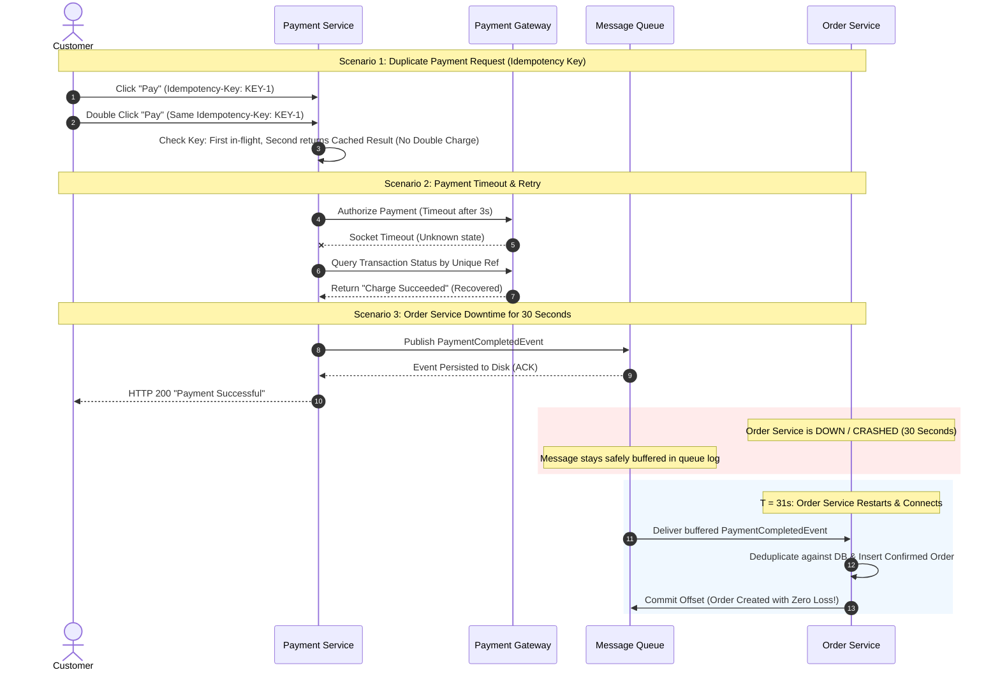

# Diagram 7: Payment & Order Failure Recovery Diagram

### Key Highlights
* **Duplicate Protection:** Duplicate clicks carrying the same `Idempotency-Key` are resolved from the cache/database with zero duplicate charges.
* **Timeout Reconciliation:** Payment timeouts query the gateway status by unique reference before deciding to charge or abort.
* **Durable Queue Buffering:** If the Order Service crashes for 30 seconds post-payment, events buffer safely on message queue disks.
* **Automatic Consumer Catch-up:** Upon reboot, the Order Service consumes all pending messages and materializes orders with 100% data preservation.
