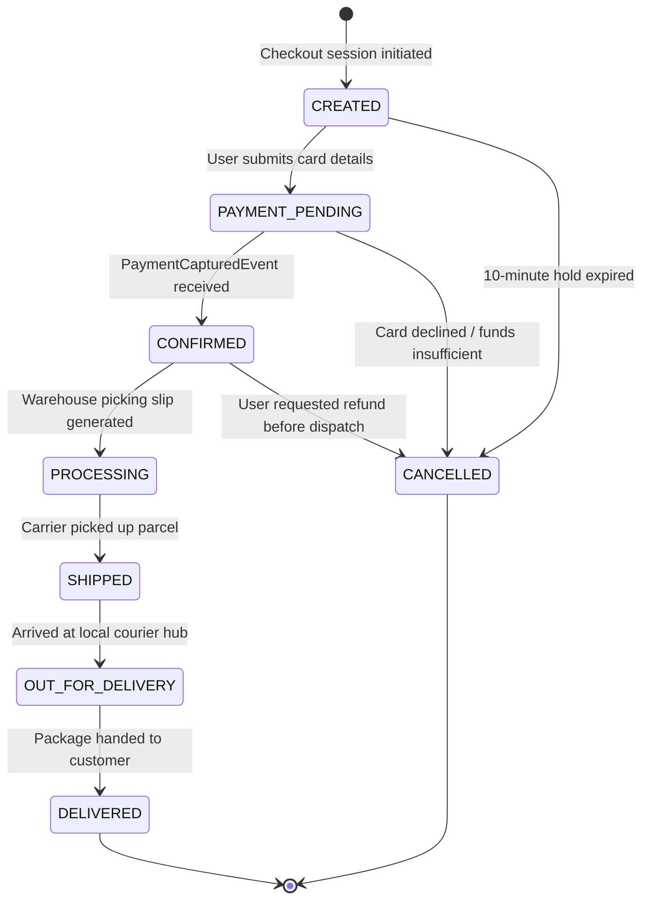

# Order State Machine Diagram

### Key Highlights
* **Order Flow:** Tracks orders from creation through payment, warehouse packing, and final delivery.
* **Payment Gate:** Orders can only enter `CONFIRMED` upon receiving a verified payment event.
* **Cancellation Guard:** Once an order transitions to `SHIPPED`, self-service cancellation is disabled to prevent package loss.
