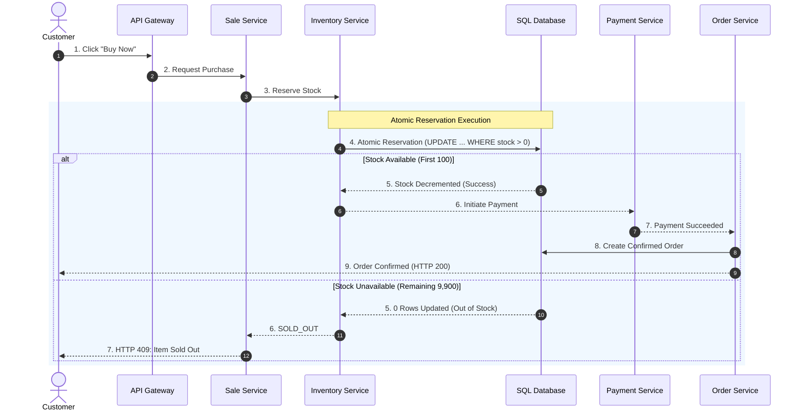

# Diagram 6: Purchase Sequence Diagram

### Key Highlights
* **End-to-End Flow:** Traces a purchase from customer click through gateway, sale, inventory reservation, payment, and order creation.
* **Atomic Gate:** The Database/Cache atomic reservation determines whether the flow branches to payment or immediate rejection.
* **Winning Path:** Successful stock holds immediately trigger payment processing and order confirmation.
* **Failing Path:** Requests past 100 receive an immediate `SOLD_OUT` response, terminating without invoking payment rails.
