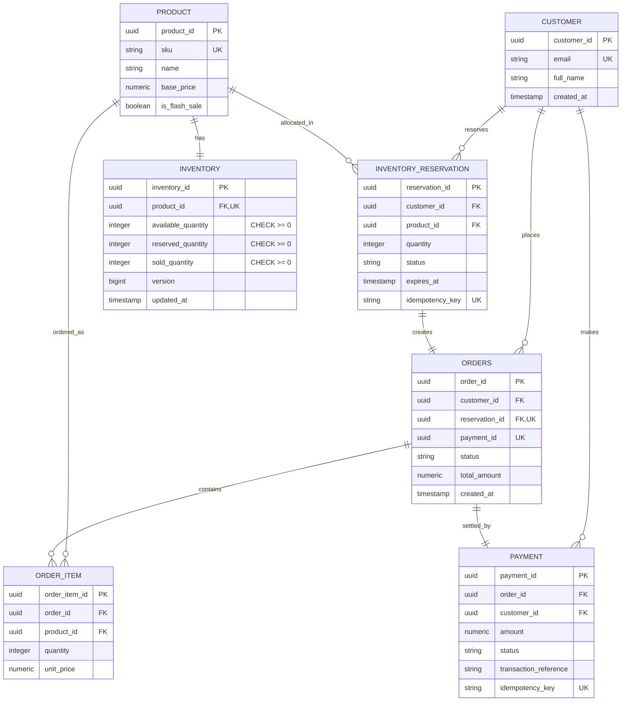

# Diagram 9: Database Entity-Relationship (ER) Diagram

### Key Highlights
* **7 Core Entities:** Contains only the entities essential to flash sales: Customer, Product, Inventory, Reservation, Order, OrderItem, and Payment.
* **Non-Negative Constraints:** `available_quantity`, `reserved_quantity`, and `sold_quantity` have database check constraints forbidding negative numbers.
* **Idempotency Uniqueness:** Both `INVENTORY_RESERVATION` and `PAYMENT` enforce unique constraints on `idempotency_key` to prevent duplicates.
* **1-to-1 Protection:** Orders strictly require a valid, non-expired `reservation_id` to exist.
