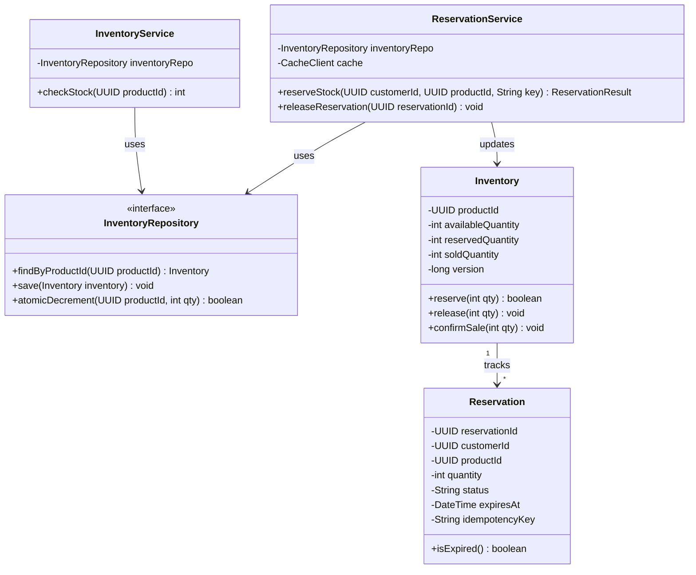

# Diagram 10A: Inventory LLD Class Diagram

### Key Highlights
* **Inventory Aggregate:** Enforces invariant `available + reserved + sold == total` within domain boundaries.
* **ReservationService:** Coordinates fast in-memory checks with cache and records durable reservations.
* **InventoryRepository:** Encapsulates atomic SQL updates (`UPDATE inventory SET available = available - 1 WHERE available > 0`).
