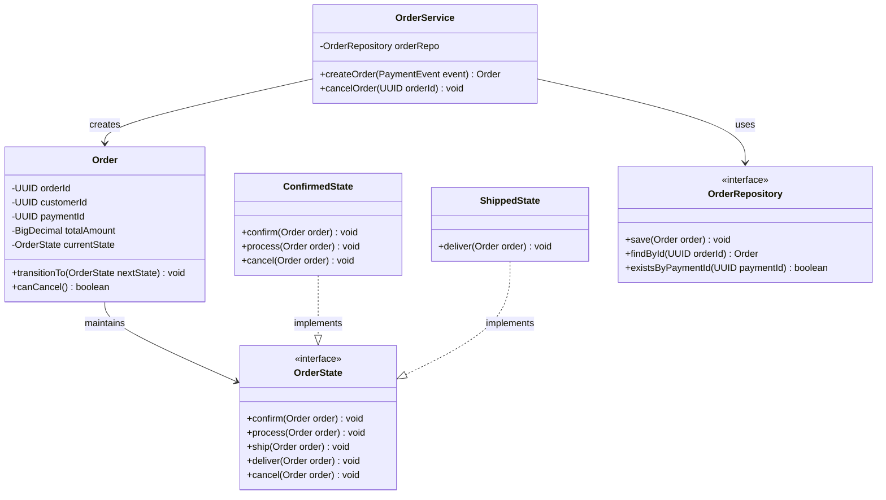

# Diagram 10C: Order LLD Class Diagram

### Key Highlights
* **Order Aggregate:** Encapsulates order identity and items; state changes pass through `transitionTo()`.
* **State Pattern:** `OrderState` prevents illegal state jumps (e.g. canceling an order already shipped).
* **Deduplication Check:** `OrderRepository.existsByPaymentId()` prevents duplicate orders during consumer retries.
