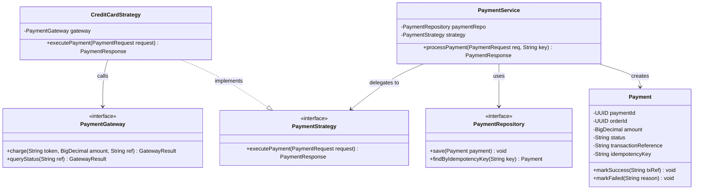

# Diagram 10B: Payment LLD Class Diagram

### Key Highlights
* **PaymentService:** Coordinates payment requests and checks `PaymentRepository` to guarantee idempotency.
* **PaymentStrategy:** Strategy Pattern allowing pluggable payment methods without altering core business rules.
* **PaymentGateway:** Adapter Pattern isolating external payment gateway APIs (Stripe, Adyen).
